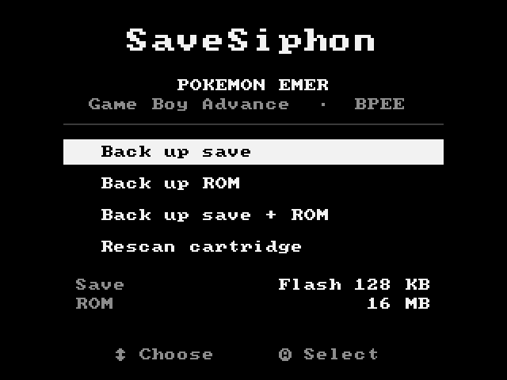
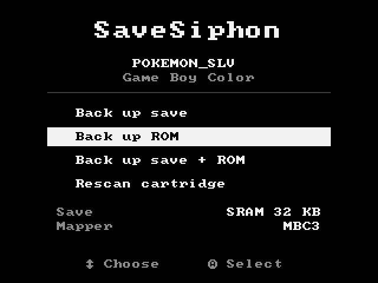
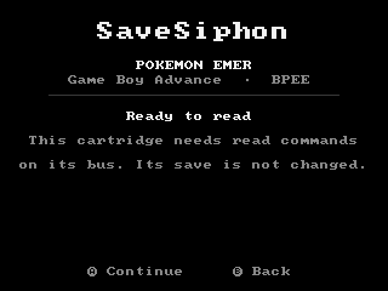
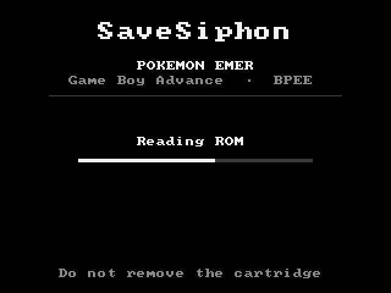
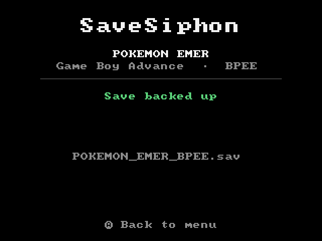

# SaveSiphon

Back up **saves and ROMs** from physical **Game Boy, Game Boy Color and Game Boy Advance** cartridges on an **Analogue Pocket**, straight to the SD card. No PC and no cart reader needed. The output is a plain `.sav` / `.gba` / `.gb` / `.gbc` that works in mGBA, SameBoy and other emulators.

SaveSiphon is **read-only**: it never writes save data to a cartridge (see [Safety](#safety)).

<p align="center">
  
  
</p>
<p align="center">
  
  
  
</p>

<sub>Screens rendered from the RTL in simulation (`sim/tb_screen.v`).</sub>

## What it backs up

| | Saves | ROM |
|---|---|---|
| **GBA** | SRAM/FRAM 32 KB, Flash 64 KB, Flash 128 KB (Pokémon), EEPROM 512 B / 8 KB | 256 KB – 32 MB, size auto-detected |
| **GB / GBC** | Cartridge RAM 2–128 KB (MBC1, MBC3, MBC5, ROM+RAM), MBC2 512 B | 32 KB – 8 MB (ROM-only, MBC1, MBC2, MBC3, MBC5) |

Not supported yet: MBC3 real-time clock data, MBC6/MBC7, MMM01, HuC1/HuC3, Pocket Camera. Unsupported mappers are refused rather than guessed.

## Status

**Beta.** Every path passes simulation against cartridge models (see `sim/`), and GBA save detection and reading has been run on real hardware. ROM backup and Game Boy support are new. Hardware reports are welcome: open an issue with the game, what the screen showed, and whether the file works in an emulator.

## Install

**pupdate:** once SaveSiphon is listed in the openFPGA inventory, it shows up there.

**Manually:** download `psspssr.SaveSiphon_<version>.zip` from [Releases](../../releases) and merge its `Assets`, `Cores` and `Platforms` folders into the root of the SD card. On macOS, copy the folders' *contents*, because Finder replaces folders instead of merging them.

Requires current Pocket firmware (2.x).

## Use

1. With the Pocket **powered off**, insert the cartridge.
2. Power on, and open **openFPGA → SaveSiphon** (under *Tools*).
3. SaveSiphon reads the cartridge, then shows what it found. Pick **Back up save**, **Back up ROM** or **Back up save + ROM** with the D-pad and **A**.
4. Some cartridges need commands on their bus to be read (GBA Flash 128 KB and EEPROM, and Game Boy mapper banking). SaveSiphon asks first: **A** to continue, **B** to go back.
5. Files land in `/Assets/savesiphon/common/`:
   * GBA: `POKEMON_EMER_BPEE.sav`, `POKEMON_EMER_BPEE.gba`
   * GB/GBC: `POKEMON_SLV.sav`, `POKEMON_SLV.gbc`

Nothing is ever overwritten. A second backup of the same game becomes `…_1.sav`, then `_2`, and so on. Always power off before swapping cartridges.

## Safety

SaveSiphon is built to **only read** your cartridge. Several independent layers enforce that:

1. **Read-only by design.** SRAM and 64 KiB Flash saves, and the whole ROM, are read with plain read strobes. The bus engine has no code path that writes there.
2. **Narrowly-defined commands, hard-coded.** Only these ever go to a cartridge:
   * **Flash 128 KiB bank select**: `AA→5555, 55→2AAA, B0→5555, 00|01→0000`. These are constants. No path can emit an erase (`80`) or program (`A0`) command, and the chip is returned to bank 0 afterwards.
   * **EEPROM read requests**: the serial pattern `1 1 <address> 0`. The second bit is a constant `1`, so an EEPROM *write* command (`1 0 …`) cannot be formed.
   * **Game Boy mapper registers**: bank-select writes to `0000–7FFF`, with the RAM chip-select never asserted. At `0000–1FFF` the only values allowed are `0A` (RAM enable, for reading) and `00` (disable). RAM is disabled again straight after every read, and the mapper is put back on bank 1 / mode 0.
3. **You confirm first.** Whenever any of those is needed, the core stops and asks: **A** to continue, **B** to cancel. The bus is released while it waits.
4. **Independent hardware write guard** (`cart_write_guard.v`). It sits on the WR# pin itself and does not trust the sequencer. Every write strobe is checked against the exact allowed sequence using only the values on the pins: address, data, chip selects, and EEPROM bit position. In Game Boy mode, any write with the RAM chip-select low or at `8000+` is refused, so cartridge RAM can't be written even if everything else failed. Anything else never reaches the cartridge, and the core latches **SAFETY STOP** until restarted. It also stops on bus contention (CS1#+CS2# or RD#+WR# low together) and on any signal moving mid-strobe.
5. **Clean strobes even when interrupted.** If the core is reset mid-write, WR# is raised while the data is still held, so a cut-off strobe can't latch a floating value.
6. **Header validation.** A cartridge whose header fails the logo, fixed-byte and checksum checks is never touched beyond reading the header.
7. **Verified dumps.** Every save, and every 64 KB / 16 KB chunk of a ROM, is read twice and both CRC32s must match (up to 3 attempts). Otherwise it reports **Unstable read** and stops.
8. **Swap and power-loss detection.** The header is re-read after dumping and must be identical (**CARTRIDGE CHANGED** otherwise). Losing slot power halts the core at once.
9. **Never overwrites dumps.** Existing files on the SD card are kept, and new dumps get `_1`, `_2`, ….
10. **Pins released when idle.** Once a dump finishes or fails, the core stops driving the cartridge bus.

The simulation suite (`sim/run_all.sh`) covers all of this. It injects a corrupted Flash command, an EEPROM write command and a Game Boy cartridge-RAM write into the sequencer, and checks the guard blocks each one before it reaches the cart model. It also checks that a swapped cart, unstable contacts and a cancel at the prompt each stop without writing a file.

## How it works

1. **Detect.** Reads the GBA header and validates it (logo, fixed byte, checksum). If that fails, switches the bus to Game Boy mode and validates the GB header (logo, checksum).
2. **GBA save type.** GBA headers carry no save type, so SaveSiphon scans the ROM for the save-library string Nintendo's SDK links into every retail game (`SRAM_V`, `FLASH_V`, `FLASH512_V`, `FLASH1M_V`, `EEPROM_V`). EEPROM size is told apart by reading 64 blocks with 14-bit addressing: a 512 B chip only decodes 6 bits and answers the same block every time.
3. **GBA ROM size.** Past the end of a GBA ROM nothing drives the bus, so a read returns the address that was just put on it. SaveSiphon probes candidate sizes at four spread-out points and takes the first size where all four read as open bus or as a mirror of the start.
4. **Game Boy.** Mapper, ROM size and RAM size come from the header (`0x147–0x149`). Banks are selected through the mapper registers.
5. **Write.** Opens a file through APF target commands (`0x0192` open/create, `0x0184` write in chunks).

Source: `src/fpga/core/`: `siphon_ctrl.v` (sequencer), `gba_cart_bus.v` / `gb_cart_bus.v` (bus timing), `cart_write_guard.v`, and `status_screen.v` (generated by `scripts/gen_screen.py`).

## Build

CI builds every push with Quartus Lite 21.1 in Docker (`raetro/quartus`). Pushing a `v*` tag publishes a release zip.

Locally:

```sh
sim/run_all.sh                       # cartridge-model simulations (needs iverilog)
cd src/fpga && quartus_sh --flow compile ap_core
scripts/package.sh src/fpga/output_files/ap_core.rbf 0.1.0 dist
```

## Credits

* Analogue's [openFPGA core template](https://github.com/open-fpga/core-template) (`src/fpga/apf`, bridge and PLL).
* The hardware notes in [openfpga-carttools](https://github.com/kroy-the-rabbit/openfpga-carttools) documented the Pocket's GBA pin mapping, the EEPROM block-alias size probe, and the APF file-path conventions that work on real hardware. 
* [font8x8](https://github.com/dhepper/font8x8) by Daniel Hepper (public domain).
* Feature scope compared against [ChisKit](https://github.com/gpzi994/ChisKit). No ChisKit code is used.

## License

MIT for the SaveSiphon sources. `src/fpga/apf/` and the template-derived files are provided by Analogue under their own terms.
